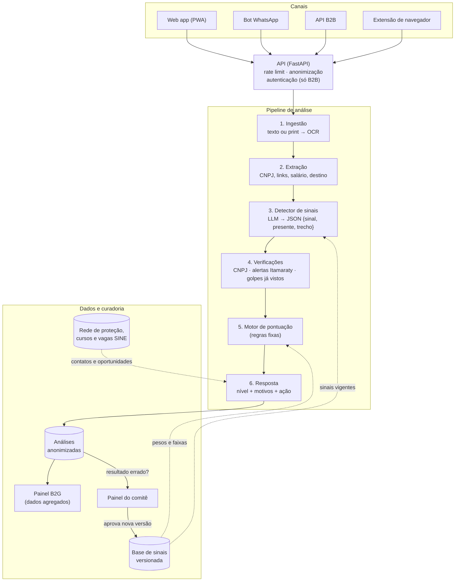

# Vaga Certa: arquitetura da solução

O Vaga Certa analisa ofertas de emprego e aponta sinais de aliciamento para tráfico de pessoas e exploração. A solução tem três blocos:

- **Canais:** por onde a vaga chega.
- **Pipeline de análise:** etapas com responsabilidades separadas.
- **Dados e curadoria:** mantém a base de sinais atualizada.

**Princípio central:** a IA detecta os sinais e a nota é calculada por regras fixas e auditáveis.

## Visão geral

Linhas cheias mostram o fluxo de uma análise. Linhas tracejadas mostram os dados que alimentam o pipeline. O ciclo à esquerda, no fim do diagrama, é a curadoria: relatos de "resultado errado" passam pelo comitê, que aprova novas versões da base de sinais.

Código-fonte do diagrama (Mermaid)

## Canais

| Canal | Público | Observação |
|---|---|---|
| Web app (PWA) | Usuárias | Canal do MVP. Sem login, com botão de saída rápida |
| Bot de WhatsApp | Usuárias | É onde as vagas falsas circulam. Usa a WhatsApp Business Cloud API |
| API B2B | Plataformas de vagas, classificados, RH | Autenticação por chave e cobrança por análise |
| Extensão de navegador | Usuárias e profissionais da rede | Analisa a vaga aberta na página |

## Pipeline de análise

1. **Ingestão**
   - Recebe o texto colado ou o print.
   - Prints passam por OCR: Tesseract no MVP, OCR em nuvem em produção.
   - Dados de quem pergunta (por exemplo, o número de WhatsApp) são descartados ou guardados só como hash.
2. **Extração**
   - Identifica as entidades do anúncio: CNPJ, telefone do recrutador, links, salário e destino.
   - Combina regex com LLM.
3. **Detecção de sinais**
   - O LLM recebe o anúncio e a lista de sinais vigente.
   - Devolve um JSON com cada sinal (`id`, `presente`, `trecho`).
   - Regras simples complementam a detecção, por exemplo "não há CNPJ no texto".
4. **Verificações externas**
   - Situação e atividade do CNPJ, via BrasilAPI ou Receita Federal.
   - Destino comparado com a lista de alertas oficiais do Itamaraty.
   - Busca por similaridade (embeddings) contra golpes já registrados, para pegar o mesmo golpe repostado.
5. **Motor de pontuação**
   - Soma os pesos dos sinais presentes.
   - Aplica as regras de elevação:
     - qualquer sinal crítico leva a vaga a **Alto**;
     - viagem paga (S05) junto com exposição pessoal (S09 a S13) também leva a **Alto**.
   - Faixas: Baixo de 0 a 3, Atenção de 4 a 7 e Alto a partir de 8.
   - Lê a versão aprovada da base de sinais, então mudar um peso não exige alterar código.
6. **Resposta**
   - Monta o nível, os sinais com os trechos do anúncio e a ação recomendada.
   - Inclui contatos da rede local e cursos ou vagas do SINE.
   - O LLM só reescreve o texto em linguagem simples e não altera a nota.
   - No nível Baixo, nunca diz que a vaga é "segura": diz que não encontrou sinais relevantes.

## Dados e curadoria

| Componente | Conteúdo | Tecnologia sugerida |
|---|---|---|
| Base de sinais | Sinais, pesos, críticos, combinações e faixas, com versão | PostgreSQL |
| Painel do comitê | Aprovação de sinais novos e revisão periódica | Interface administrativa simples |
| Rede e oportunidades | Equipamentos da rede de proteção, cursos gratuitos e vagas SINE por cidade | PostgreSQL |
| Registro de análises | Texto do anúncio, sinais, nota e cidade opcional, sem identificar a usuária | PostgreSQL, com retenção limitada |
| Painel B2G | Indicadores agregados: tipos de vaga, regiões, destinos e sinais frequentes | Metabase ou Superset |

**Ciclo de melhoria:** "resultado errado?" → fila de curadoria → conjunto rotulado → teste de regressão do detector → nova versão aprovada da base.

## Decisões de projeto

- **Resistência a prompt injection.** O texto do anúncio é tratado como não confiável. O LLM só preenche o JSON de sinais e não decide a nota.
- **LGPD por padrão.**
  - Sem login para a usuária.
  - Fica salvo apenas o anúncio e o resultado, com retenção limitada.
  - O painel do governo mostra só dados agregados.
  - O fornecedor do LLM é configurado para não usar os dados em treinamento.
- **Qualidade medida.**
  - O conjunto rotulado funciona como teste de regressão.
  - Mudanças de prompt, modelo ou peso precisam manter a taxa de acerto.
  - A métrica prioritária é não deixar passar vagas de aliciamento (recall).
- **Segurança da usuária.** Botão de saída rápida e nenhum histórico visível no aparelho.

## Stack sugerida

| Camada | Tecnologia |
|---|---|
| Front-end (MVP) | Streamlit |
| Front-end (produção) | PWA (React ou similar) |
| API | Python + FastAPI |
| LLM | API de LLM com saída estruturada em JSON |
| OCR | Tesseract (MVP), OCR em nuvem (produção) |
| Banco de dados | PostgreSQL (+ pgvector para similaridade) |
| Fila (WhatsApp) | Redis |
| Painéis | Metabase ou Superset |
| Infraestrutura | Contêineres Docker em nuvem |

## Escopo do MVP (hackathon)

| Item | Status no MVP |
|---|---|
| Tela com caixa de texto e upload de print | Implementado (Streamlit) |
| Detecção dos 21 sinais com LLM, retornando JSON | Implementado |
| Pontuação em Python, com pesos lidos de CSV exportado da planilha | Implementado |
| Consulta de CNPJ via BrasilAPI | Implementado |
| Contatos da rede no Ceará e alguns cursos | Tabela fixa |
| Bot de WhatsApp, painel B2G e curadoria | Telas mockadas |
| Dados | Apenas anúncios sintéticos criados pela equipe (itens 11.5 e 14.2 do regulamento) |
